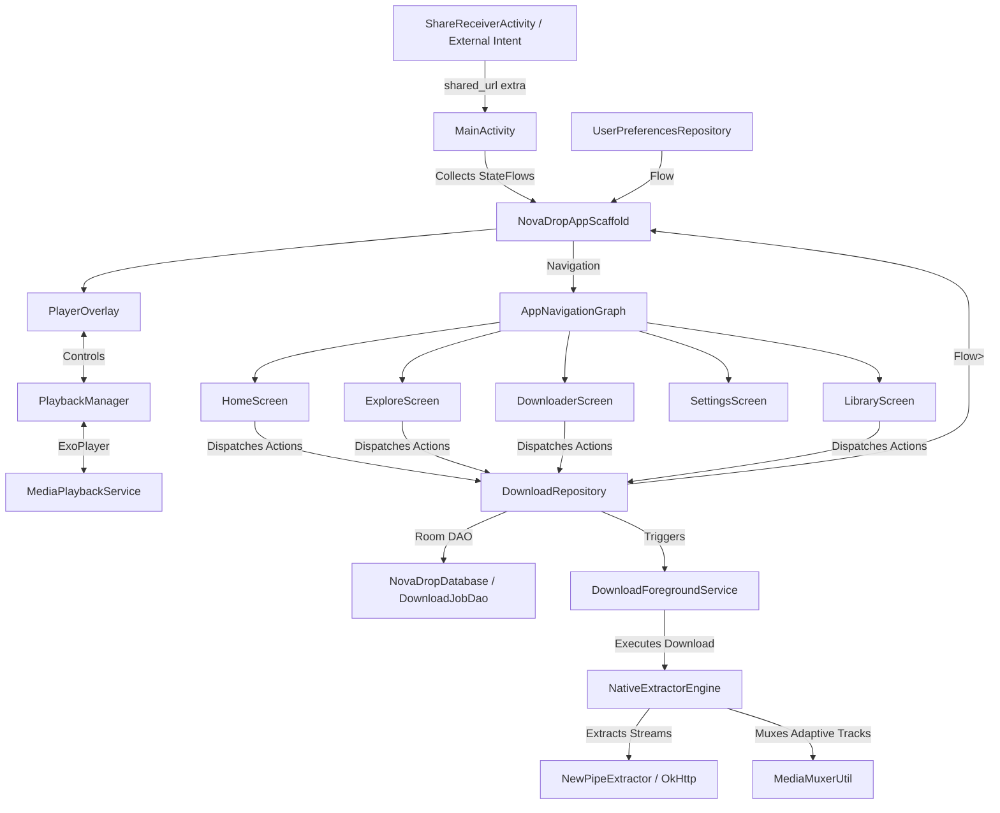

# NovaDrop Android — Comprehensive Project Onboarding & Architecture Discovery

> **Document Status:** Complete & Verified Baseline  
> **Last Updated:** Current Session  
> **Target SDK:** 35 (Android 15) | **Min SDK:** 26 (Android 8.0) | **Kotlin Target:** JVM 21  
> **Build Status:** PASSED (`:app:assembleDebug`) | **Unit Tests:** 61 PASSED, 0 FAILED (`:app:testDebugUnitTest`)

---

## 1. Project Purpose & Verified Scope

**NovaDrop Android** is a high-performance native Android media downloading, extraction, and playback application built with Kotlin, Jetpack Compose, Material 3, and Media3 (ExoPlayer).

### Core Capabilities & Intended Purpose
- **Media Extraction:** Downloads video, audio/music, and images/galleries from supported online platforms (YouTube, Reddit, Booru imageboards, direct media URLs).
- **Native Extraction Engine:** Utilizes [TeamNewPipe/NewPipeExtractor](https://github.com/TeamNewPipe/NewPipeExtractor) (`v0.26.5`) for YouTube stream parsing, combined with custom Regex/JSON extractors for Reddit and Booru platforms.
- **Adaptive Stream Muxing:** Downloads high-definition video-only (1080p, 1440p, 2160p MP4) and audio-only (M4A/AAC) streams in parallel and multiplexes them on-device without re-encoding using Android's native [MediaMuxer](class://android.media.MediaMuxer) (`MediaMuxerUtil.kt`).
- **Background Execution:** Runs foreground service execution with `PARTIAL_WAKE_LOCK` and system notifications via [DownloadForegroundService](class://com.novadrop.android.service.DownloadForegroundService).
- **Rate-Limit Intelligence:** Parses platform rate-limiting errors (HTTP 429) and schedules automatic retry backoffs via [RateLimitParser](class://com.novadrop.android.core.util.RateLimitParser).
- **Integrated Playback:** Features a integrated Media3 ExoPlayer player overlay supporting mini-player transitions, fullscreen playback, position tracking, and speed control via [PlaybackManager](class://com.novadrop.android.playback.PlaybackManager).

### Scope Boundaries
- **In-Scope:** Everything within `android/` directory (`com.novadrop.android`).
- **Out-of-Scope:** Surrounding Windows applications, parent directory files outside `android/`, and third-party tools.

---

## 2. Actual Project Structure

The project is structured as a single-module Android application project (`:app`) using standard Gradle Kotlin DSL configuration.

```
android/
├── build.gradle.kts                          # Root build script (AGP 8.7.3, Kotlin 2.0.21, KSP 2.0.21)
├── settings.gradle.kts                       # Root project settings & repositories (Google, MavenCentral, JitPack)
├── gradle.properties                         # GradleJVM properties & AndroidX flags
├── docs/                                     # Self-contained project documentation
│   ├── PROJECT_ONBOARDING.md
│   ├── SCREEN_AND_COMPONENT_INVENTORY.md
│   └── UI_REDESIGN_ROADMAP.md
└── app/
    ├── build.gradle.kts                      # Module build script (Dependencies, SDK 35, Java 21)
    ├── proguard-rules.pro                    # R8 keep rules for NewPipeExtractor & Room
    └── src/
        ├── main/
        │   ├── AndroidManifest.xml           # Manifest declarations, permissions, services
        │   ├── res/                          # Strings, colors, XML file provider paths
        │   └── java/com/novadrop/android/
        │       ├── NovaDropApp.kt            # Application singleton, dependency initializer
        │       ├── core/
        │       │   ├── model/
        │       │   │   └── Models.kt         # Domain data classes (DownloadJob, UserPreferences, etc.)
        │       │   └── util/
        │       │       ├── Formatters.kt     # Byte, duration, view, and tool formatting
        │       │       ├── RateLimitParser.kt# HTTP 429 & reset timestamp parser
        │       │       └── Validators.kt     # URL, query, jobId, and filename sanitization
        │       ├── data/
        │       │   ├── local/
        │       │   │   ├── NovaDropDatabase.kt # Room database instance (v1)
        │       │   │   ├── dao/              # DownloadJobDao, SearchHistoryDao
        │       │   │   └── entity/           # DownloadJobEntity, SearchHistoryEntity
        │       │   ├── preferences/
        │       │   │   └── UserPreferencesRepository.kt # DataStore preferences flow
        │       │   └── repository/
        │       │       └── DownloadRepositoryImpl.kt # Repository implementation
        │       ├── domain/
        │       │   ├── engine/
        │       │   │   └── MediaExtractorEngine.kt   # Extractor engine interface
        │       │   └── repository/
        │       │       └── DownloadRepository.kt     # Repository interface
        │       ├── engine/
        │       │   ├── muxer/
        │       │   │   └── MediaMuxerUtil.kt         # Native MediaMuxer stream copy muxer
        │       │   ├── native/
        │       │   │   └── NativeExtractorEngine.kt  # Concrete engine implementation
        │       │   └── newpipe/
        │       │       └── NewPipeDownloaderImpl.kt  # OkHttp wrapper for NewPipe
        │       ├── playback/
        │       │   ├── MediaPlaybackService.kt       # Media3 MediaSessionService
        │       │   └── PlaybackManager.kt            # ExoPlayer state holder & controls
        │       ├── service/
        │       │   ├── DownloadForegroundService.kt  # Foreground service & wake lock
        │       │   └── NotificationHelper.kt         # Download & playback notifications
        │       └── ui/
        │           ├── MainActivity.kt               # Main entry activity & Scaffold
        │           ├── ShareReceiverActivity.kt      # Intent target for ACTION_SEND
        │           ├── components/                   # Shared UI composable components
        │           ├── downloader/
        │           │   └── DownloaderScreen.kt       # Queue management screen
        │           ├── explore/
        │           │   └── ExploreScreen.kt          # URL analyzer & YouTube search
        │           ├── home/
        │           │   └── HomeScreen.kt             # Dashboard screen
        │           ├── library/
        │           │   └── LibraryScreen.kt          # Downloaded media manager
        │           ├── navigation/
        │           │   └── Navigation.kt             # Screen route definitions
        │           ├── player/
        │           │   └── PlayerSheet.kt            # Fullscreen & mini-player overlay
        │           ├── settings/
        │           │   └── SettingsScreen.kt         # Preferences configuration
        │           └── theme/
        │               ├── Color.kt                  # Design color tokens
        │               └── Theme.kt                  # Material 3 NovaDropTheme
        └── test/                                     # 61 Unit tests covering models, utils, engine & DAOs
```

---

## 3. Architecture Overview

NovaDrop uses an **Unidirectional Data Flow (UDF)** architecture built around Jetpack Compose, state flows, Room persistence, and Android System Services.



### Architectural Highlights
1. **Manual Dependency Injection:** Handled directly in `NovaDropApp.kt` singleton instance. Services and Activities obtain dependencies via `(application as NovaDropApp)`.
2. **State Management:** Screens obtain state by observing Kotlin `StateFlow` from repositories (`DownloadRepository`, `UserPreferencesRepository`, `PlaybackManager`) inside `MainActivity.kt` using `collectAsState()`.
3. **Download Execution:** `DownloadRepositoryImpl` enqueues jobs into Room, then starts `DownloadForegroundService`. The foreground service manages the active coroutine queue and invokes `NativeExtractorEngine.download()`.

---

## 4. Key Classes and Their Responsibilities

| Class / File | Package | Responsibility |
| :--- | :--- | :--- |
| `NovaDropApp` | `com.novadrop.android` | Application subclass. Initializes OkHttpClient, NewPipe, Room Database, Repositories, and PlaybackManager. |
| `MainActivity` | `com.novadrop.android.ui` | Main launcher activity. Observes preferences, downloads, and searches; hosts `NovaDropAppScaffold` and `NavHost`. |
| `ShareReceiverActivity` | `com.novadrop.android.ui` | Entry activity for `ACTION_SEND` intents (sharing links from YouTube, Twitter, Chrome). Parses URLs and redirects to `MainActivity`. |
| `DownloadJob` | `com.novadrop.android.core.model` | Primary domain data class representing a download task, including state, progress, speed, ETA, and downloaded file metadata. |
| `UserPreferences` | `com.novadrop.android.core.model` | Preferences data model (theme accent, dark mode, default format, player exit behavior, night owl settings). |
| `NativeExtractorEngine` | `com.novadrop.android.engine.native` | Core extraction engine implementing `MediaExtractorEngine`. Parses YouTube, Reddit, and Booru media, executes HTTP downloads, and calls `MediaMuxerUtil`. |
| `MediaMuxerUtil` | `com.novadrop.android.engine.muxer` | Interleaves and multiplexes separate MP4 video and M4A audio tracks into a unified MP4 file using Android's native `MediaMuxer` and `MediaExtractor`. |
| `DownloadRepositoryImpl` | `com.novadrop.android.data.repository` | Implements `DownloadRepository`. Coordinates Room database queries and triggers `DownloadForegroundService`. |
| `DownloadForegroundService` | `com.novadrop.android.service` | Android `ForegroundService` with `PARTIAL_WAKE_LOCK`. Manages active download jobs in coroutines and updates foreground notifications. |
| `PlaybackManager` | `com.novadrop.android.playback` | Singleton managing ExoPlayer instance, active media playback state, mini-player status, and position tracking. |
| `MediaPlaybackService` | `com.novadrop.android.playback` | Media3 `MediaSessionService` that binds ExoPlayer to the system media session and notification controls. |

---

## 5. Main Application Execution Flows

### Flow 1: Shared URL / Intent Handling
1. External app shares link to NovaDrop -> `ShareReceiverActivity` receives `ACTION_SEND` with `text/plain`.
2. `ShareReceiverActivity.extractUrl()` extracts the first HTTP/HTTPS URL from text using Regex.
3. Fires `Intent` to `MainActivity` with `putExtra("shared_url", targetUrl)`.
4. `MainActivity` sets `sharedUrlState.value`, which triggers a `LaunchedEffect` in `NovaDropAppScaffold` navigating directly to `Screen.Explore`.

### Flow 2: Quick Download & Analysis
1. User enters URL in `HomeScreen` or `ExploreScreen` and clicks "Analyze".
2. `NativeExtractorEngine.extractMetadata()` checks URL host:
   - YouTube: `StreamInfo.getInfo(ServiceList.YouTube, url)` parses progressive/adaptive formats.
   - Reddit: Fetches `.json` post endpoint to discover Reddit video `fallback_url`.
   - Booru: Fetches post JSON API to extract `file_url`.
3. Extracted metadata returned as `ExtractionMetadata`. User selects format preset and clicks "Download".
4. `DownloadRepositoryImpl.enqueueJob()` inserts `DownloadJobEntity` into Room and calls `DownloadForegroundService.startDownload(context, jobId)`.

### Flow 3: Adaptive Video Muxing Execution
1. `DownloadForegroundService` receives `ACTION_START` and launches a job coroutine.
2. Calls `NativeExtractorEngine.download(job)`:
   - For 1080p/1440p/2160p video, downloads `videoOnlyStream` (0%..65% progress) to `temp_video.mp4`.
   - Downloads `audioStream` (65%..88% progress) to `temp_audio.m4a`.
   - Invokes `MediaMuxerUtil.mux(tempVideo, tempAudio, destinationFile)` (88%..100% progress).
3. Validates output file header magic bytes (`validateOutputFile()`).
4. Scans media file via `MediaScannerConnection.scanFile()` so file appears in Android System Gallery.
5. Updates Room entity state to `COMPLETED`.

---

## 6. Screen Inventory & Navigation Map

NovaDrop uses `androidx.navigation.compose.NavHost` with 5 main destinations:

```
[Home ("home")] ──────────> [Explore ("explore")]
      │                             │
      ▼                             ▼
[Downloader ("downloader")] <───────┴─── [Library ("library")]
      │
      ▼
[Settings ("settings")]
```

| Screen | Route | Key Purpose | Primary Composable |
| :--- | :--- | :--- | :--- |
| **Home** | `"home"` | Quick URL input bar, active queue summary, platform tags, recent downloads list | `HomeScreen.kt` |
| **Explore** | `"explore"` | URL analyzer, metadata preview with format picker, YouTube live search | `ExploreScreen.kt` |
| **Downloader** | `"downloader"` | Live download queue manager, progress bars, pause/resume/cancel/retry, scheduled countdowns | `DownloaderScreen.kt` |
| **Library** | `"library"` | Catalog of downloaded media files, category filtering (Video/Music/Images), grid/list toggle, sharing | `LibraryScreen.kt` |
| **Settings** | `"settings"` | Accordion settings for formats, storage directories, theme accents, player exit behavior, night owl scheduler | `SettingsScreen.kt` |
| **Player Overlay** | Floating Overlay | ExoPlayer view sheet supporting mini-player bottom bar & fullscreen controls | `PlayerSheet.kt` (`PlayerOverlay`) |

---

## 7. Current Design System & Reusable Components

### Color Tokens & Palette (`Color.kt` & `Theme.kt`)
- **Dark Backgrounds:** `BgDark` (`#090A0F`), `SurfaceDark` (`#121520`), `SurfaceCard` (`#1A1E2E`), `SurfaceBorder` (`#242A40`).
- **5 Theme Accent Options:**
  1. `ocean` (Default): `OceanBlue` (`#38BDF8`)
  2. `emerald`: `EmeraldMint` (`#00E599`)
  3. `violet`: `VioletGlow` (`#7C6DFA`)
  4. `amber`: `SolarAmber` (`#F59E0B`)
  5. `rose`: `CrimsonRose` (`#F43F5E`)
- **Status Indicators:** `StatusSuccess` (`#10B981`), `StatusWarning` (`#F59E0B`), `StatusError` (`#EF4444`).

---

## 8. UI/UX Audit Findings

### Strengths
- Clean Material 3 color system with customizable accent palettes.
- Adaptive layout support (`BoxWithConstraints` toggling between `NavigationRail` for wide screens >= 600dp and `NavigationBar` for narrow phones).
- Good state-driven status feedback (color-coded progress bars, rate-limit countdown timers, animated mini-player).

### High-Priority Improvement Opportunities
1. **Hardcoded Strings & Dimensions:** Most text strings in screens are inline hardcoded strings instead of referencing `res/values/strings.xml`. Spacing (12.dp, 16.dp) is repeated across screens without standard spacing tokens.
2. **Missing Edge-to-Edge System Bar Handling:** `WindowInsets` and IME insets are not explicitly handled in screen scaffolds, causing potential overlap under status/navigation bars on modern gesture navigation devices.
3. **UI Logic Coupling:** Screen composables directly launch coroutines for database operations (`app.database.searchHistoryDao().insertSearch()`) rather than delegating to ViewModels.
4. **Touch Target Sizes:** Several small icon buttons (e.g., delete/share in grid cards) are `16.dp` to `24.dp`, below the recommended Material 3 minimum `48.dp` touch target size.

---

## 9. Functionality Baseline & Verification Status

| Feature / Domain | Status | Verification Evidence |
| :--- | :--- | :--- |
| **URL Validation & Normalization** | **Verified** | `ValidatorsTest.kt` & `FormattersTest.kt` passing. |
| **Rate Limit Parsing (HTTP 429)** | **Verified** | `RateLimitParserTest.kt` passing with relative and timestamp regex cases. |
| **YouTube Extraction & Stream Resolution** | **Verified** | `YouTubeExtractionTest.kt` passing with live stream byte header checks (`ftyp`). |
| **End-to-End YouTube Downloads** | **Verified** | `LiveDownloadEndToEndTest.kt` passing with real video/audio file outputs. |
| **Native Stream Copy Muxing (MediaMuxer)** | **Verified** | `DeterministicExtractionEngineTest.kt` passing with header & magic byte checks. |
| **Room Database Persistence & Entities** | **Verified** | `DownloadJobEntityTest.kt` domain-entity roundtrip tests passing. |
| **Queue State Transitions** | **Verified** | `QueueStateTransitionTest.kt` testing PENDING->RUNNING->COMPLETED/SCHEDULED. |
| **Foreground Service & Wake Lock** | **Implemented, unverified** | Code present in `DownloadForegroundService.kt`; manual device test needed. |
| **Media3 ExoPlayer Playback & Mini-Player** | **Implemented, unverified** | Code present in `PlaybackManager.kt` & `PlayerSheet.kt`; manual device test needed. |
| **DataStore User Preferences** | **Implemented, unverified** | Code present in `UserPreferencesRepository.kt`. |

---

## 10. Important Technical Constraints

1. **MediaMuxer Container Compatibility:** Android's native `MediaMuxer` MP4 output format strictly requires H.264/HEVC video streams and AAC (`audio/mp4a-latm`) audio streams. Combining WebM (VP9/Opus) into MP4 via MediaMuxer will fail.
2. **Foreground Service Types:** App declares `foregroundServiceType="dataSync"` for `DownloadForegroundService` and `mediaPlayback` for `MediaPlaybackService`. On Android 14+ (API 34+), foreground service permissions must be declared in `AndroidManifest.xml`.
3. **Scoped Storage Permissions:** Android 10+ (API 29+) uses Scoped Storage (`Environment.DIRECTORY_DOWNLOADS/NovaDrop`). Legacy write permissions are capped at `maxSdkVersion="28"`.
4. **Java 21 / Desugaring:** Project uses Java 21 compatibility with `isCoreLibraryDesugaringEnabled = true` (`com.android.tools:desugar_jdk_libs:2.1.3`).

---

## 11. Build & Test Baseline

### Executed Verification Commands
1. **Unit Test Suite:**
   ```bash
   ./gradlew app:testDebugUnitTest
   ```
   **Result:** `61 passed, 0 skipped, 0 failed`
2. **Debug Compilation:**
   ```bash
   ./gradlew app:assembleDebug
   ```
   **Result:** `BUILD SUCCESSFUL`

---

## 12. Known Issues, Risks & Uncertainties

- **Architecture Refactoring Risk:** UI screens directly depend on `NovaDropApp` application instance and execute DB calls. Introducing ViewModels should be done incrementally to prevent breaking state propagation.
- **NewPipeExtractor Breaking Changes:** External platform changes by YouTube may break stream extraction. `NewPipeExtractor` updates must be monitored.

---

## 13. Recommended Order of Future UI Work

1. **Phase 1: Foundation & Design Tokens** (Centralize theme, colors, typography, strings, and spacing tokens).
2. **Phase 2: Edge-to-Edge & System Insets** (Apply `enableEdgeToEdge()` and insets padding to scaffolds).
3. **Phase 3: Screen ViewModels & State Holders** (Extract screen logic into ViewModels with UI state data classes).
4. **Phase 4: Component Polish & Accessibility** (Increase touch target sizes, add M3 Expressive card motion and empty states).

---

## 14. Essential Files to Inspect Before Modifying Screens

- `app/src/main/java/com/novadrop/android/ui/MainActivity.kt` (Root scaffold & Navigation graph)
- `app/src/main/java/com/novadrop/android/ui/theme/Theme.kt` & `Color.kt` (Theme configuration)
- `app/src/main/java/com/novadrop/android/core/model/Models.kt` (Core data contracts)
- `app/src/main/java/com/novadrop/android/ui/player/PlayerSheet.kt` (Global player overlay)
