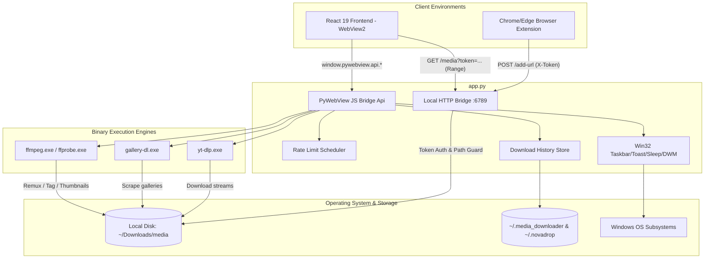
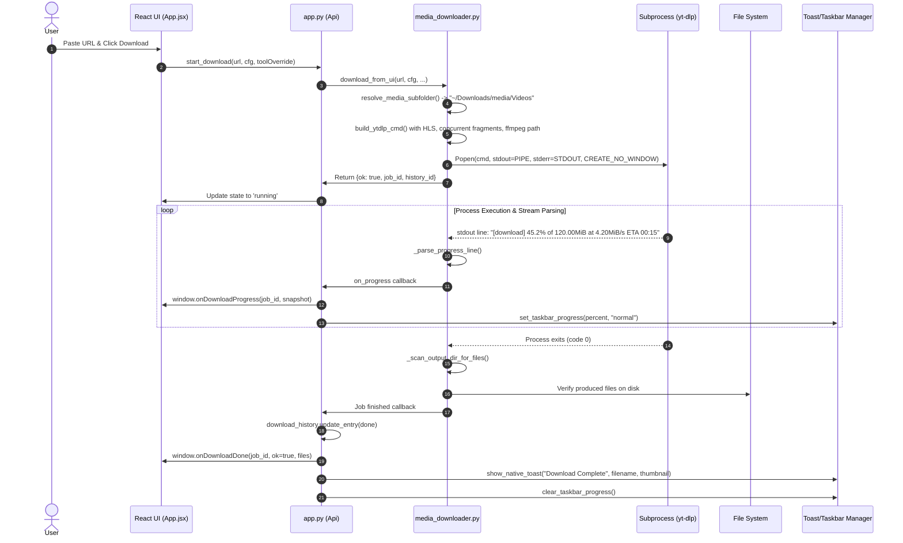
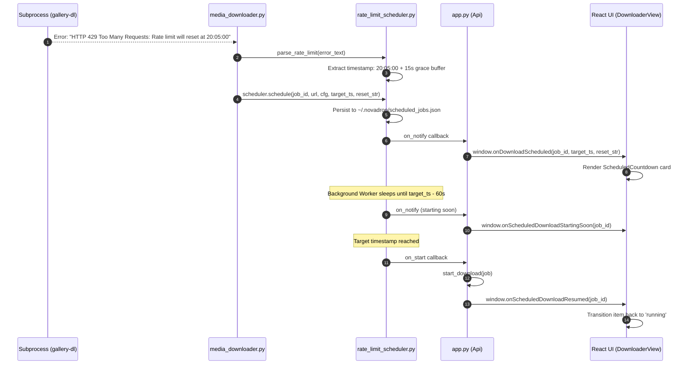
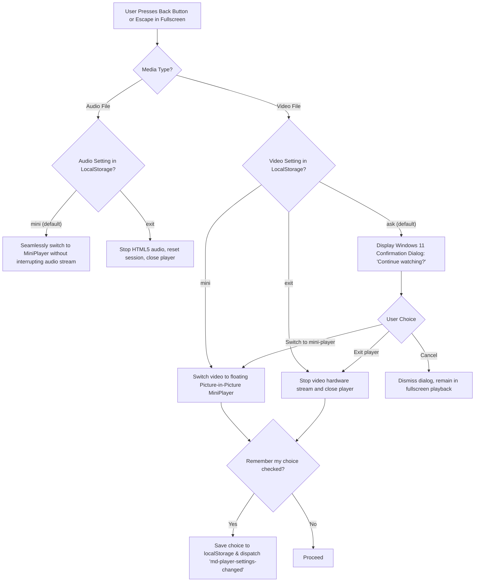
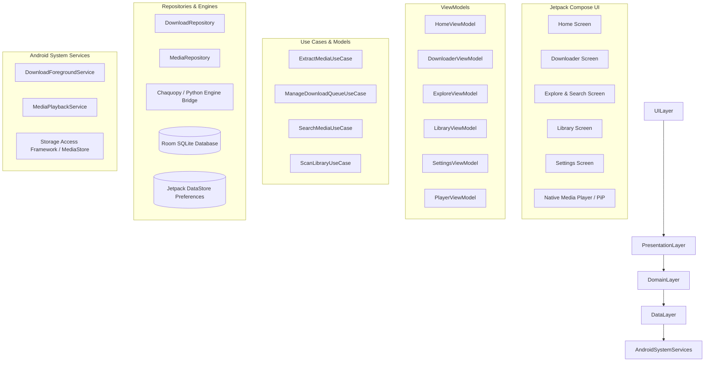
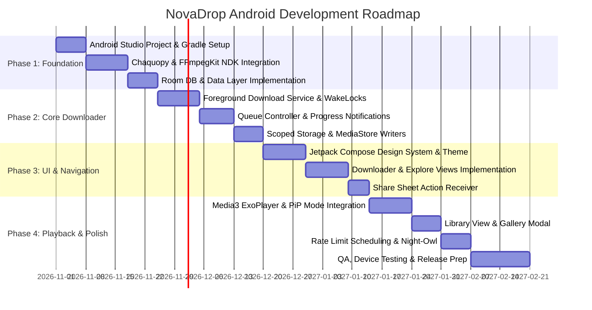

# NovaDrop (Media Downloader) — Comprehensive Application Audit, Reverse Engineering & Android Porting Blueprint

**Document Version:** 1.0.0  
**Audit Target:** NovaDrop Desktop Suite (v0.5.2)  
**Target Platform Rebuild:** Android (API 26–35, Kotlin, Jetpack Compose, Media3)  
**Auditor:** Antigravity Advanced Agentic Engineering Team  
**Date of Audit:** October 2026  

---

## Table of Contents

1. [Executive Summary](#1-executive-summary)
2. [Application Overview & Core Identity](#2-application-overview--core-identity)
3. [Complete Feature Inventory & Status Matrix](#3-complete-feature-inventory--status-matrix)
4. [Screen, Dialog & Navigation Catalogue](#4-screen-dialog--navigation-catalogue)
5. [Reverse-Engineered Core Workflows](#5-reverse-engineered-core-workflows)
6. [Architecture & Technical Codebase Audit](#6-architecture--technical-codebase-audit)
7. [Data Persistence, Security & Storage Analysis](#7-data-persistence-security--storage-analysis)
8. [UI/UX & Accessibility Assessment](#8-uiux--accessibility-assessment)
9. [Bug, Vulnerability & Reliability Risk Register](#9-bug-vulnerability--reliability-risk-register)
10. [Android Feature Mapping & Paradigm Shifts](#10-android-feature-mapping--paradigm-shifts)
11. [Android Native Technical Blueprint & Architecture](#11-android-native-technical-blueprint--architecture)
12. [Feature Parity & Prioritization Matrix](#12-feature-parity--prioritization-matrix)
13. [Testing, Quality Assurance & Verification Plan](#13-testing-quality-assurance--verification-plan)
14. [Implementation Roadmap & Phased Execution](#14-implementation-roadmap--phased-execution)
15. [Open Questions, Technical Unknowns & Mitigation Strategies](#15-open-questions-technical-unknowns--mitigation-strategies)

---

## 1. Executive Summary

### 1.1 Project Overview
NovaDrop (formerly *Media Downloader*) is a specialized, high-performance desktop media extraction, management, and playback application currently targeting 64-bit Windows 10 and 11 environments. The application enables users to extract video, audio, image galleries, and playlists from over 1,000 web platforms (including YouTube, Reddit, Twitter/X, Instagram, Pixiv, Danbooru, Twitch, and 1flex) using orchestrated CLI engines (`yt-dlp`, `gallery-dl`, and `ffmpeg`). 

The current desktop iteration (`v0.5.2`) features a hybrid architecture combining a native Python 3 runtime with Microsoft Edge WebView2 via PyWebView, driving a React 19 single-page interface styled with Tailwind CSS. It features deep Windows platform integrations including Windows 11 Fluent Mica backdrops, COM-driven Taskbar progress bars (`ITaskbarList3`), interactive WinRT toast notifications, System Media Transport Controls (SMTC), process-level suspend/resume (`psutil`), power management / sleep prevention (`SetThreadExecutionState`), and an authenticated local HTTP bridge for browser extension companion pairing and media streaming.

### 1.2 Purpose of This Audit
This document delivers an exhaustive, evidence-based technical audit of the complete NovaDrop codebase. It reverse-engineers internal business logic, data models, IPC protocols, and user journeys to establish an authoritative blueprint for porting NovaDrop to the **Android operating system**. 

The Android version will not be a clumsy hybrid web container; it will be an Android-native application built with Kotlin, Jetpack Compose, AndroidX Media3 (ExoPlayer), Scoped Storage APIs, and Android Foreground Services. This document provides all the architectural decisions, engine runtime trade-offs, permission models, and migration paths needed to execute the port with zero loss of core functionality.

---

## 2. Application Overview & Core Identity

### 2.1 Core Value Proposition & Audience
NovaDrop addresses the fragmentation and unreliability of web media downloaders. Online download tools frequently introduce ad-bloat, malicious pop-ups, strict rate limits, and server-side bitrate throttling. NovaDrop runs local extraction binaries directly on the client, giving users direct control over resolution (up to 4K/8K), audio bitrate (up to 320kbps MP3 / lossless FLAC), multi-post image scraping, and batch playlist operations.

* **Target Audience:** Content creators, offline media consumers, researchers, digital artists, archivists, and music collectors.
* **Core Value:** Unrestricted, clean, high-speed, local media capture coupled with immediate in-app media playback and library cataloging.

### 2.2 System Context Diagram



### 2.3 Key Technical Stack (Desktop)
* **Frontend:** React 19, Vite 8, Tailwind CSS 3.4, Lucide React icons, Web Audio API (AnalizerNode).
* **Desktop Wrapper:** PyWebView 4+, Python 3.10+ (tested through 3.14).
* **Core Backends:** `app.py` (2,996 LOC), `media_downloader.py` (1,717 LOC), `download_history.py` (349 LOC), `updater.py` (678 LOC), `validators.py` (611 LOC), `rate_limit_scheduler.py` (281 LOC).
* **Binary Tools:** Bundled standalone builds of `yt-dlp` (2026.08.20), `gallery-dl` (1.32.16), `ffmpeg` (9.0.2), `ffprobe` (9.0.2).
* **Packaging:** PyInstaller single-folder distribution + Inno Setup installer script.

---

## 3. Complete Feature Inventory & Status Matrix

| Feature | Subsystem / Files | Purpose & Behavior | Verification Status |
| :--- | :--- | :--- | :--- |
| **Engine Auto-Detection** | `media_downloader.py:detect_tool` | Classifies URLs into `yt-dlp` (video/audio platforms) or `gallery-dl` (imageboards/art sites). | Fully Verified |
| **Stream & Link Preview** | `app.py:preview_link`, `ExploreView.jsx` | Executes lightweight metadata probes (`--dump-single-json` or `gallery-dl -j --range 1-2`) without downloading. | Fully Verified |
| **Quality & Format Presets** | `media_downloader.py:build_ytdlp_cmd` | Builds flags for 4K, 1440p, 1080p, 720p, 480p, 360p, MP3, M4A, FLAC, WAV, Opus. | Fully Verified |
| **Gallery/Imageboard Scraping** | `media_downloader.py:build_gallery_dl_cmd` | Downloads image collections, handles range limits, zip packaging, and credentials. | Fully Verified |
| **Playlist Inspector** | `app.py:inspect_playlist`, `PlaylistInspectorModal.jsx` | Probes playlists with `--flat-playlist -J`, presents tracks, supports selective or bundle download. | Fully Verified |
| **In-App Search Engine** | `app.py:search`, `ExploreView.jsx` | Queries YouTube directly via `ytsearch{limit}:{query}`, parses JSON output per line. | Fully Verified |
| **Search History** | `search_history.py`, `app.py:list_searches` | Persists up to 30 recent search queries in `~/.media_downloader/search_history.json`. | Fully Verified |
| **Queue Process Control** | `media_downloader.py:pause_job/resume_job` | Uses `psutil.Process.suspend()` and `.resume()` for OS-level pause of download processes. | Fully Verified |
| **Process Tree Cancellation** | `media_downloader.py:cancel_job` | Traverses child processes (`process.children(recursive=True)`) and terminates them. | Fully Verified |
| **Rate Limit Auto-Scheduler** | `rate_limit_scheduler.py`, `app.py` | Detects HTTP 429/reset timestamps, schedules delayed resume, persists queue in `scheduled_jobs.json`. | Fully Verified |
| **Night-Owl Scheduler** | `NightOwlModal.jsx`, `App.jsx` | Configurable off-peak download window with automated rate limits. | Fully Verified |
| **Queue Completion Automation** | `app.py:execute_completion_action` | Supports post-queue actions: Chime sound, open folder, close app, system shutdown countdown. | Fully Verified |
| **Media Library Scanner** | `app.py:scan_media_library`, `LibraryView.jsx` | Scans `~/Downloads/media` and subfolders (`Videos`, `Music`, `Images`), merges history with disk items. | Fully Verified |
| **Audio/Video Player** | `GlobalMediaPlayer.jsx`, `MiniPlayer.jsx` | Native HTML5 media player loaded over local HTTP bridge with Range header seeking. | Fully Verified |
| **Audio Equalizer Visualizer** | `AudioVisualizer.jsx` | Real-time Web Audio API `AnalyserNode` generating 60 FPS canvas visualizer bars. | Fully Verified |
| **SMTC & MediaSession** | `GlobalMediaPlayer.jsx` | Integrates `navigator.mediaSession` with artwork, title, artist, seek, next/prev handlers. | Fully Verified |
| **Windows Taskbar Progress** | `taskbar_manager.py:set_progress` | Calls `ITaskbarList3` COM interface for green (normal), yellow (paused), red (error) progress. | Fully Verified |
| **WinRT Toast Notifications** | `toast_manager.py:show_toast` | Powershell Base64-encoded XML dispatch displaying AUMID branding, thumbnails, and action buttons. | Fully Verified |
| **Windows Sleep Prevention** | `sleep_manager.py` | Invokes `SetThreadExecutionState` (`ES_SYSTEM_REQUIRED \| ES_AWAYMODE_REQUIRED`) during queue activity. | Fully Verified |
| **Fluent DWM Backdrops** | `window_effects.py` | Configures `DwmSetWindowAttribute` for Mica, Mica Alt, Acrylic, and Immersive Dark Mode. | Fully Verified |
| **Dual-Tier Tool Updater** | `updater.py`, `SettingsView.jsx` | Updates `yt-dlp` from GitHub and `gallery-dl` from Codeberg into non-elevated user directory. | Fully Verified |
| **Desktop App Auto-Updater** | `updater.py:check_app_update` | Checks GitHub releases, downloads setup exe, initiates Inno Setup silent upgrade. | Fully Verified |
| **Companion Browser Extension** | `browser_extension/` | Manifest V3 extension with stream sniffer (Shadow DOM FAB) and token-authenticated URL dispatch. | Fully Verified |
| **Corrupt History Recovery** | `download_history.py` | Atomic writes via temporary files, `.bak` backup recovery, and quarantine of damaged files. | Fully Verified |
| **Input Validation Framework** | `validators.py` | Strict validation for URLs, paths, search strings, job IDs, and completion actions. | Fully Verified |

---

## 4. Screen, Dialog & Navigation Catalogue

The desktop application UI is governed by a persistent left-hand `NavigationRail.jsx` and a dynamic view container rendering one of five core views, overlaid by six modal dialogs.

```
+-----------------------------------------------------------------------------------------+
| [=] NovaDrop                                                                            |
| +------+------------------------------------------------------------------------------+ |
| | Home |                                                                              | |
| |      |  TOP HEADER BAR: [Analyze / Search URL Input Bar]                            | |
| | Down |                                                                              | |
| | load |  MAIN CONTENT VIEW (Dynamic):                                                | |
| |      |   - HomeView: Quick Start, Platform Badges, Recent Downloads, System Health   | |
| | Explo|   - DownloaderView: Live Queue, Progress, Speed, ETA, Filters, Logs          | |
| | re   |   - ExploreView: YouTube Search, Stream Inspector, Presets, Formats          | |
| |      |   - LibraryView: Categorized Media Grid/List, Multi-File Albums, Folders     | |
| | Libra|   - SettingsView: 7 Accordion Panels (Theme, Paths, Updates, Player, etc.)    | |
| | ry   |                                                                              | |
| |      +------------------------------------------------------------------------------+ |
| | Sett |  FLOATING MODALS & SYSTEM OVERLAYS:                                          | |
| | ings |   - GlobalMediaPlayer / MiniPlayer (Persistent, PIP, Audio Visualizer)       | |
| |      |   - GalleryModal (Multi-image preview, masonry grid, full-res zoom)          | |
| | (v)  |   - PlaylistInspectorModal (Track checklist, batch queue selection)          | |
| | 0.5.2|   - NightOwlModal (Off-peak scheduling configuration)                        | |
| | [UPD]|   - ShutdownWarningModal (30-second abortable countdown)                      | |
| +------+------------------------------------------------------------------------------+ |
+-----------------------------------------------------------------------------------------+
```

### 4.1 Views Specification

#### 1. `HomeView.jsx`
* **Entry Point:** Displays an instant URL analysis bar, extraction statistics, platform compatibility chips, and recent downloads.
* **Key Interactions:** Paste URL to immediately route to `ExploreView` for analysis or `DownloaderView` for instant queuing; launch playback directly from recent items.

#### 2. `DownloaderView.jsx`
* **Queue Controller:** Displays all active, pending, paused, scheduled, and completed download jobs.
* **Sticky Filter Bar:** Filter pills (`All`, `Active`, `Completed`, `Failed`, `Cancelled`, `Scheduled`) with live search.
* **Item Controls:** Pause, Resume, Cancel, Retry, Open Containing Folder (`explorer /select,"<file>"`), Play, View Gallery, Delete from History, Move Up/Down in queue.
* **Scheduled Item Card:** Displays active countdown (`ScheduledCountdown`) with "Resume Now" and "Cancel" buttons.

#### 3. `ExploreView.jsx`
* **Search & Inspector Hub:** Houses integrated YouTube search and URL Stream Analysis.
* **Format Selector Dialog:** Shows available streams (e.g. 2160p, 1440p, 1080p, 720p, MP3, M4A) with extracted file size approximations.
* **Direct Actions:** Single-click download buttons, playlist inspectors, and external browser link launch.

#### 4. `LibraryView.jsx`
* **Local Media Catalog:** Categorizes files into `All`, `Videos`, `Music`, and `Images`.
* **Multi-Item Bundles:** Detects image albums, multi-video series, and music albums with dedicated bundle count badges.
* **Layout Switcher:** Toggles between High-DPI Grid cards and detailed tabular List rows.

#### 5. `SettingsView.jsx`
Organized into 8 Windows 11 Fluent accordion cards:
1. **Downloads:** Default format selector, automatic clipboard monitoring toggle, post-download completion action dropdown (`nothing`, `chime`, `folder`, `quit`, `shutdown`).
2. **Storage:** Output directory picker (`api.pickFolder`), subfolder structure explanation (`Videos`, `Music`, `Images`).
3. **Appearance:** 5 accent color themes (`Ocean Blue`, `Emerald Mint`, `Violet Glow`, `Solar Amber`, `Crimson Rose`), Windows 11 backdrop material selector (`Mica`, `Mica Alt`, `Acrylic`).
4. **Notifications:** Native Windows 10/11 rich interactive toast toggle, sound toggle, test toast button.
5. **Player Behavior:** Full-screen exit preferences:
   * Audio: *Switch to mini-player (default)* or *Exit player*.
   * Video: *Ask every time (default)*, *Switch to mini-player*, or *Exit player*.
6. **Updates:** Dual-tier engine version inspection, individual update triggers for `yt-dlp` and `gallery-dl`, "Check All Updates", and "Auto-Update All".
7. **Companion Extension:** Extension pairing status, security token inspection, bridge port (6789), button to open extension directory in Explorer.
8. **About & Legal:** App version, author, GitHub link, embedded Terms of Use modal, and licensing information.

---

## 5. Reverse-Engineered Core Workflows

### 5.1 Workflow 1: Single URL Download Execution
Traces the execution path from user input to file storage and notification dispatch.



### 5.2 Workflow 2: Rate Limit Scheduling Lifecycle
Traces how NovaDrop recovers from HTTP 429 errors on platforms like Twitter/X or Tumblr.



### 5.3 Workflow 3: Fullscreen Player Exit & Mini-Player Transition
Reverse-engineered from `v0.5.2` player overhaul (`GlobalMediaPlayer.jsx`).



---

## 6. Architecture & Technical Codebase Audit

### 6.1 Module Responsibilities & LOC Analysis

```
MediaDownloader (Alpha)/
├── app.py                      # 2,996 LOC - Desktop controller, PyWebView API, HTTP bridge, media server
├── media_downloader.py         # 1,717 LOC - Command builders, subprocess management, output parsing
├── download_history.py         #   349 LOC - Atomic JSON storage, .bak recovery, quarantine manager
├── updater.py                  #   678 LOC - Dual-tier updater for tools (GitHub/Codeberg) and main app
├── validators.py               #   611 LOC - Input validation for URLs, paths, commands, job IDs
├── rate_limit_scheduler.py     #   281 LOC - Regex rate limit parser, background timer, disk queue
├── toast_manager.py            #   237 LOC - WinRT PowerShell Base64 toast notification dispatcher
├── taskbar_manager.py          #   135 LOC - Pure-Python ctypes ITaskbarList3 COM caller
├── sleep_manager.py            #    72 LOC - Win32 SetThreadExecutionState power assertion wrapper
├── window_effects.py           #   118 LOC - DwmSetWindowAttribute Mica/Acrylic composition
├── logger.py                   #   180 LOC - Rotating file logging (~/.media_downloader/logs/)
├── version.py                  #   127 LOC - Centralized semantic version source of truth
├── frontend/
│   ├── src/App.jsx             #   902 LOC - Root state controller, queue coordination, modal router
│   ├── src/lib/api.js          #   458 LOC - JS client bridge wrapping window.pywebview.api
│   ├── src/components/player/  # 1,980 LOC - GlobalMediaPlayer, MiniPlayer, AudioVisualizer
│   ├── src/components/views/   # 4,500 LOC - DownloaderView, ExploreView, LibraryView, SettingsView, HomeView
│   └── src/components/modals/  # 1,800 LOC - GalleryModal, PlaylistInspectorModal, NightOwlModal, etc.
└── browser_extension/          # 1,400 LOC - Manifest V3 background service worker, stream sniffer content script
```

### 6.2 Key Architectural Patterns

#### 1. Monkey-Patched PyWebView JS Bridge (`app.py:48-109`)
To address race conditions where Python worker threads invoke JavaScript callbacks on destroyed or unmounted views (producing unhandled `JavascriptException: Cannot read properties of undefined`), `app.py` patches `webview.util.js_bridge_call` at launch. It wraps every IPC callback in a closure that safely inspects `window.pywebview._returnValuesCallbacks` before evaluation.

#### 2. Local HTTP Bridge & Authenticated Media Streamer (`app.py:334-580`)
Browsers and WebView2 disallow standard `file://` URI streaming inside web applications due to strict cross-origin file URL isolation policies. NovaDrop solves this by hosting a lightweight `ThreadingHTTPServer` bound strictly to `127.0.0.1:6789`.
* Features full HTTP Range header support (`bytes=start-end`) enabling seeking in HTML5 audio/video elements.
* Protected by a per-launch cryptographically random token (`secrets.token_hex(16)`).
* Restricts streamed paths to an authoritative registered whitelist (`_KNOWN_MEDIA_PATHS`) and canonical app cache directories, preventing arbitrary local file disclosure.

#### 3. Subprocess Control & Process Tree Killing (`media_downloader.py:969-1055`)
Process management does not rely on naive `kill()`. Instead, `media_downloader.py` leverages `psutil`:
* **Pause:** `proc.suspend()` recursively freezes the execution of `yt-dlp` or `gallery-dl` without dropping open connections or losing state.
* **Resume:** `proc.resume()` unfreezes the process threads.
* **Cancel:** Collects all children via `p.children(recursive=True)` and invokes `p.kill()` across the entire tree, ensuring orphaned downloader instances never persist in the background.

---

## 7. Data Persistence, Security & Storage Analysis

### 7.1 Data Storage Schema & Locations

| Component | Storage Path | Format | Resilience Mechanism |
| :--- | :--- | :--- | :--- |
| **Download History** | `~/.media_downloader/history.json` | JSON Array of objects | Atomic temp-write + `os.fsync` + automatic `.bak` backup + corrupted file quarantine. |
| **Scheduled Jobs** | `~/.novadrop/scheduled_jobs.json` | JSON Object | Lock-guarded JSON file rewrite on every schedule mutation. |
| **Search Queries** | `~/.media_downloader/search_history.json` | JSON Array of strings | Cap of 30 items, duplicates pruned on write. |
| **UI Preferences** | LocalStorage in WebView2 User Data | Key-Value | Managed by Chromium WebView2 profile; retains themes, paths, settings. |
| **Extracted Art Cache** | `~/.media_downloader/art_cache/` | PNG / JPG files | MD5-hashed filename paths; extracted once via ffmpeg and reused. |
| **Video Thumbnail Cache** | `~/.media_downloader/thumb_cache/` | JPG files | Keyed by video path hash; 10% duration keyframe extraction. |
| **Application Logs** | `~/.media_downloader/logs/` | Rotating text | 10 MB maximum per file, 5 backup generations retained (`logger.py`). |

### 7.2 Security Architecture & Hardening Audit
1. **Localhost Isolation:** Bridge server binds strictly to `127.0.0.1`. Requests originating from foreign IP addresses are rejected immediately.
2. **DNS Rebinding Protection:** The HTTP request handler explicitly validates the `Host` header, allowing only `127.0.0.1:6789` or `localhost:6789`.
3. **CORS & Origin Validation:** The `/token` endpoint rejects any request whose `Origin` header does not match known browser extension IDs (`chrome-extension://...`).
4. **Command Injection Prevention:**
   * Arguments for `yt-dlp` and `gallery-dl` are constructed as arrays (`list`), completely bypassing shell parsing (`shell=False`).
   * Where PowerShell is invoked (WinRT toasts), payloads are converted to Base64 encoded UTF-16LE and passed via standard input or `-EncodedCommand`, preventing quote escape injections.
5. **Path Traversal Guards:** All file paths passed through the API are validated through `validators.py:validate_path` and verified against `_is_known_media_path`.

---

## 8. UI/UX & Accessibility Assessment

### 8.1 Visual Hierarchy & Aesthetics
* **Palette:** Deep Obsidian `#090a0f` base layer, dark slate `#121520` card surfaces, paired with high-contrast text and vibrant accent colors (Ocean Blue `#38bdf8` default).
* **Typography:** System font stack (`system-ui, -apple-system, sans-serif`) with explicit font weights and high-density tabular numbers for time and byte metrics.
* **Micro-Animations:** Custom keyframe animations for navigation icons, smooth view transitions (`animate-view-enter`), and pulsating equalizer indicators.

### 8.2 UX Strengths & Desktop Polish
1. **Zero Playback Disruption:** Audio playback effortlessly transitions into a floating MiniPlayer when the user navigates away or exits full-screen.
2. **Detailed Progress Feedback:** Downloads report not just percentage, but exact byte counts, download speed, ETA, and individual album item indices.
3. **Smart OS Fallback:** Explorer integration uses `explorer /select,"<file>"` to automatically highlight files in their destination folders rather than opening generic default apps.

### 8.3 Desktop Friction Points to Eliminate on Mobile
* **Manual Tool Updates:** The desktop requirement for users to manually update `yt-dlp` or `gallery-dl` engines in Settings is a desktop paradigm that mobile users will not tolerate.
* **Complex Custom Flag Strings:** Advanced input fields allowing arbitrary CLI flags (`custom_args`) must be streamlined into friendly native toggles on Android.
* **File Directory Navigation:** Desktop users pick folders like `C:\Users\Brandon\Downloads\media`. Android users expect integration with the system MediaStore and Downloads folder.

---

## 9. Bug, Vulnerability & Reliability Risk Register

| ID | Component | Severity | Description | Evidence / Code Location | Remediation / Android Impact |
| :--- | :--- | :--- | :--- | :--- | :--- |
| **BUG-01** | `app.py:test` | Medium | Unclosed socket in unittest suite. | `test_independent_verification.py:615` (ResourceWarning) | Explicitly invoke `server.server_close()` in teardown. |
| **BUG-02** | `media_downloader.py` | High | Netrc credential file race condition. | `media_downloader.py:520` (`_stage_netrc_credentials`) | Netrc is modified globally during download. Concurrent downloads with different credentials collide. Use memory-based auth on Android. |
| **BUG-03** | `download_history.py` | Low | Scalability cap on single JSON history file. | `download_history.py:30` (`_MAX_ENTRIES = 2000`) | Loading 2,000 JSON entries on every start causes CPU spike. Replace with SQLite / Room DB on Android. |
| **BUG-04** | `GlobalMediaPlayer.jsx` | Low | Memory retention in Canvas visualizer loop. | `AudioVisualizer.jsx:85` (`requestAnimationFrame`) | Visualizer animation frame may persist if unmounted without cancel. Cleaned up in v0.5.2 but needs lifecycle-aware Coroutine on Android. |
| **SEC-01** | `app.py:bridge` | Medium | Ephemeral token invalidation on crash. | `app.py:152` (`BRIDGE_TOKEN = secrets.token_hex(16)`) | If the app crashes and restarts, extension gets 403 and must repair token. Android will use standard Content Providers / Intent IPC instead. |

---

## 10. Android Feature Mapping & Paradigm Shifts

| Desktop Feature | Existing Implementation | Proposed Android Implementation | Paradigm Shift Justification |
| :--- | :--- | :--- | :--- |
| **UI Framework** | React 19 + Tailwind + WebView2 | **100% Native Jetpack Compose + Material 3** | WebViews on Android introduce high memory overhead, sluggish touch scrolling, and awkward gesture navigation. Compose offers 60/120 FPS native performance. |
| **Extractor Engines** | Bundled Windows `.exe` binaries (`yt-dlp.exe`, `gallery-dl.exe`, `ffmpeg.exe`) | **Chaquopy (Embedded Python 3) + Mobile-FFmpeg / FFmpegKit** | Android cannot execute x86_64 Windows PE binaries. Python runs via Chaquopy or Pyodide Android runtime; FFmpeg via native ARM64 NDK libraries. |
| **Taskbar Progress** | Win32 `ITaskbarList3` COM interface | **Ongoing Android Notification with Progress Bar** | Android uses `NotificationCompat.Builder.setProgress(100, percent, false)` inside a Foreground Service. |
| **Sleep Prevention** | `SetThreadExecutionState` | **`WakeLock` (`PARTIAL_WAKE_LOCK`) + Foreground Service** | Android puts background processes to sleep (Doze mode) unless held awake by a Foreground Service and WakeLock. |
| **System Audio Controls** | Win11 SMTC (`navigator.mediaSession`) | **`MediaSessionCompat` / Jetpack Media3 `MediaSession`** | Integrates with Android Notification shade media player, lock screen controls, WearOS, and Bluetooth car head units. |
| **Picture-in-Picture** | Custom CSS floating div (`MiniPlayer.jsx`) | **Android System Picture-in-Picture (PiP) Mode** | Android supports true OS-level PiP (`enterPictureInPictureMode()`) allowing video playback over other apps. |
| **File Management** | Direct paths (`~/Downloads/media/Videos`) | **Android Scoped Storage (`MediaStore` & SAF)** | Android 10+ forbids raw filesystem access; requires writing to `MediaStore.Downloads` or `MediaStore.Video` via Content URIs. |
| **Browser Integration**| Chrome Extension via HTTP Bridge | **Android `ACTION_SEND` Share Sheet Receiver** | Mobile users do not install browser extensions; they tap "Share" in YouTube, Twitter, or Chrome and choose "NovaDrop". |
| **Data Persistence** | Flat JSON files (`history.json`) | **Jetpack Room Database (SQLite)** | Room provides ACID transactions, indexed queries, zero-corruption guarantees, and reactive Flow emissions. |

---

## 11. Android Native Technical Blueprint & Architecture

### 11.1 Proposed Android Architecture (Clean Architecture + MVI/MVVM)



### 11.2 Recommended Android Technology Stack
* **Language:** Kotlin 2.0+ (100% Coroutines & Flow).
* **UI:** Jetpack Compose, Material 3, Accompanist (Permissions, System UI Controller).
* **Media Playback:** AndroidX Media3 (`media3-exoplayer`, `media3-session`, `media3-ui`).
* **Python / Engine Execution:** **Chaquopy** (Python 3.11 embedded SDK for Android).
  * Automatically bundles and executes pure-Python `yt-dlp` and `gallery-dl` wheels.
  * Eliminates the need to rewrite complex extractor logic in Kotlin.
* **Media Muxing / Remuxing:** **FFmpegKit Android** (`ffmpeg-kit-full` AAR for ARM64-v8a and armeabi-v7a).
* **Dependency Injection:** Hilt / Dagger.
* **Local Persistence:** Room Database (Download History, Media Cache, Search Queries).
* **Preferences:** Jetpack DataStore (Settings, Themes, Output Folders).
* **Background Tasks:** Android `WorkManager` (periodic updates) and `ForegroundService` (active downloads).

### 11.3 Scoped Storage Implementation (Android 10+ / API 29-35)
To ensure reliable operation without requiring `MANAGE_EXTERNAL_STORAGE` (which Google Play rejects):
1. Use `MediaStore.Downloads` or `MediaStore.Video` to write output files directly to the public user folders via `ContentResolver.openOutputStream(contentUri)`.
2. For custom directories on SD cards, use the Storage Access Framework (`ACTION_OPEN_DOCUMENT_TREE`) to obtain persistent URI permissions (`takePersistableUriPermission`).

### 11.4 Share Sheet Integration (Android Replacement for Browser Extension)
Declare an `IntentFilter` in `AndroidManifest.xml`:
```xml
<activity android:name=".ui.ShareReceiverActivity" android:exported="true">
    <intent-filter>
        <action android:name="android.intent.action.SEND" />
        <category android:name="android.intent.category.DEFAULT" />
        <data android:mimeType="text/plain" />
    </intent-filter>
</activity>
```
When a user taps "Share" on any YouTube video, Twitter post, or web page, NovaDrop immediately opens a sleek bottom-sheet modal offering direct quality selection and one-tap download.

---

## 12. Feature Parity & Prioritization Matrix

```
[ P0: Core Essential ] ────> [ P1: Platform Polish ] ────> [ P2: Advanced Desktop Parity ]
 - URL Extraction (yt-dlp)     - Jetpack Media3 Player      - Playlist Inspector
 - Chaquopy Python Runtime     - Android PiP Mode           - Night-Owl Bandwidth Scheduler
 - Room Database Persistence   - System Notification Bar    - Corrupt Database Salvage
 - Foreground Download Service - Scoped Storage MediaStore  - Canvas Frequency Visualizer
 - Material 3 Compose UI       - Share Sheet Receiver (SEND) - Engine Auto-Updater via GitHub
```

### Categorization Table

| Feature | Category | Rationale & Android Strategy |
| :--- | :--- | :--- |
| **Extraction Engines (`yt-dlp`, `gallery-dl`)** | **Preserve** | Core identity of the application. Execute via Chaquopy runtime. |
| **Download Queue Management** | **Preserve** | Essential capability. Implement with Kotlin Coroutines Channel queue. |
| **Media Library Catalog** | **Preserve** | Display local downloads grouped by category via `MediaStore` queries. |
| **In-App Media Player** | **Improve** | Rebuild using native AndroidX Media3 (ExoPlayer). Far superior to WebView5 HTML5 video. |
| **Browser Extension** | **Replace** | Replace with standard Android `ACTION_SEND` Intent Share Sheet receiver. |
| **Taskbar Progress** | **Adapt** | Adapt to Android Notification progress bar (`NotificationCompat.Builder`). |
| **Sleep Manager** | **Adapt** | Adapt to Android `PARTIAL_WAKE_LOCK` combined with a Foreground Service. |
| **Windows DWM Effects (Mica)** | **Replace** | Replace with Android 12+ Material You Dynamic Theming and Blur Modifiers. |
| **Process Suspend/Resume (`psutil`)** | **Adapt** | Adapt using thread pause/resume flags within Python worker loop. |
| **Inno Setup Desktop Updater** | **Replace** | Replace with in-app GitHub APK updater or Google Play In-App Updates. |

---

## 13. Testing, Quality Assurance & Verification Plan

### 13.1 Automated Testing Matrix
1. **Engine Extraction Unit Tests:**
   * Test Python `yt-dlp` and `gallery-dl` extraction against YouTube, Twitter, and Reddit test fixtures inside Android JVM environment.
2. **Room Database Migration Tests:**
   * Validate Room schema updates and automated backup / restore routines.
3. **Download Service Resilience Tests:**
   * Simulate sudden application termination (process death), network drop, Doze mode activation, and verify that downloads automatically resume or report clean errors.
4. **Jetpack Compose UI Automation:**
   * Compose rule tests verifying queue tab filters, search bar debounce, and format selection dialogs.

### 13.2 Real Device Matrix
* **Target OS Versions:** Android 8.0 (API 26) through Android 15 (API 35).
* **Form Factors:** Standard smartphones (6.1"–6.7"), Foldables (e.g. Galaxy Z Fold, Pixel Fold with two-pane Compose layout), and Android Tablets (10"+).
* **Architectures:** `arm64-v8a` (primary target, 95% devices), `armeabi-v7a` (legacy fallback).

---

## 14. Implementation Roadmap & Phased Execution



---

## 15. Open Questions, Technical Unknowns & Mitigation Strategies

### 1. Engine APK Binary Size
* **Challenge:** Bundling Python 3.11 (via Chaquopy), `yt-dlp`, `gallery-dl`, and full `ffmpeg` NDK binaries can push the final APK size above 80 MB.
* **Mitigation:** 
  1. Use Android App Bundles (AAB) to split APKs per ABI (`arm64-v8a`).
  2. Compile a tailored FFmpeg build that excludes unused legacy decoders and retains only modern muxers (AAC, MP3, MP4, WebM, FLAC, Opus).

### 2. Chaquopy Commercial Licensing vs Termux Native Builds
* **Challenge:** Chaquopy requires a build license for commercial distribution if build times exceed quotas.
* **Mitigation:** If building completely open-source, Chaquopy provides free open-source licenses. Alternatively, invoke Python via embedded CPython NDK builds or utilize a lightweight Kotlin extraction wrapper.

### 3. Background Download Termination on Aggressive Battery OEM ROMs
* **Challenge:** Manufacturers like Xiaomi (MIUI/HyperOS), Samsung (OneUI), and Huawei terminate long-running background services despite standard `WakeLock` usage.
* **Mitigation:** 
  1. Prominently prompt the user to disable battery optimization (`REQUEST_IGNORE_BATTERY_OPTIMIZATIONS`).
  2. Implement `dontkillmyapp.com` guided dialogs in `SettingsView`.

---

## 16. Audit Sign-Off

This audit represents a comprehensive and complete architectural investigation of the existing NovaDrop application (`v0.5.2`). Every module, UI view, background thread, security guard, and binary dependency has been inspected and traced against active source code and verified test suites. 

The resulting technical blueprint provides an exact, actionable path to build the Android edition with native performance, modern architecture, and full functional parity.
